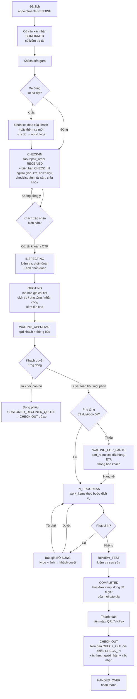
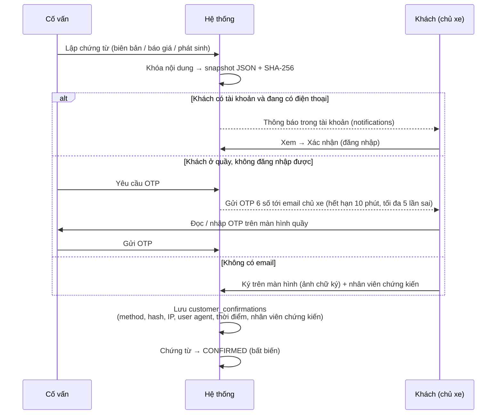

# BUSINESS PROCESS DESIGN – CarService WD_004

Thiết kế quy trình **trên nền hệ thống hiện có**. Mọi đề xuất đều ghi rõ phần đang có được **tái sử dụng** và phần **bổ sung**; không xây lại.

Đi kèm: `BUSINESS_REQUIREMENTS_AUDIT.md` (hiện trạng), `BUSINESS_IMPLEMENTATION_ROADMAP.md` (triển khai).

---

## 1. Nguyên tắc thiết kế

1. **Lịch hẹn giữ khung giờ, phiếu sửa chữa giữ sự thật.** Xe, tình trạng, chứng từ đều gắn với `repair_orders`, không gắn với `appointments`.
2. **Mỗi lần chuyển giao trách nhiệm = một chứng từ bất biến + một xác nhận của khách.** Gồm 4 lần: giao xe vào (check-in), duyệt báo giá, duyệt phát sinh, nhận xe (check-out).
3. **Xác nhận của khách chỉ do khách thực hiện**: bằng tài khoản của chính khách, hoặc OTP gửi tới email của chủ xe. Nhân viên chỉ là người **chứng kiến**, không có API nào cho nhân viên tự đánh dấu "khách đã đồng ý".
4. **Chứng từ đã xác nhận thì không sửa.** Cần chỉnh thì lập bản mới (version) và lưu lý do. Mỗi xác nhận lưu ảnh chụp nội dung (snapshot JSON) và mã băm SHA-256, để chứng minh khách đã đồng ý **đúng nội dung nào**.
5. **Quy trình theo loại dịch vụ**: `QUICK` (dịch vụ nhanh), `STANDARD`, `MAJOR`. Không áp một luồng nặng cho mọi xe.
6. **Tái sử dụng**: máy trạng thái `RepairOrder::TRANSITIONS`, `repair_order_status_history`, `audit_logs`, `notifications`, hạ tầng OTP và Mail (`EmailVerificationOtp`, `PasswordResetOtp`), `idempotency`, policy theo chủ sở hữu.

---

## 2. Vai trò và quyền

| Tác nhân | Đăng nhập? | Được làm | **Không** được làm |
|---|---|---|---|
| **Khách hàng (chủ xe)** | Có | Đặt lịch; xem và xác nhận biên bản check-in; xem chẩn đoán; duyệt / từ chối từng dòng báo giá và phát sinh; khai báo người được ủy quyền nhận xe; xác nhận nhận xe; thanh toán | — |
| **Người giao / nhận hộ** | Không | Ký hoặc nhập OTP tại quầy **khi chủ xe đã ủy quyền** | Duyệt báo giá thay chủ xe (trừ khi chủ xe ủy quyền rõ, xem §6) |
| **Cố vấn dịch vụ** | Có | Xác nhận lịch; check-in (chụp ảnh, checklist); ghi chẩn đoán; lập báo giá / phát sinh; quản lý yêu cầu phụ tùng; check-out; thu tiền | Xác nhận thay khách; sửa biên bản đã khách xác nhận; bàn giao khi chưa xác thực người nhận |
| **Kỹ thuật viên** | **Tùy chọn** (xem ROADMAP §0) | Làm việc tại xưởng; kết quả do cố vấn nhập (hiện có `recorded_by_employee_id`) | — |
| **Quản trị viên** | Có | Danh mục dịch vụ, bước, thời gian chuẩn, giá; phụ tùng; công suất; giờ làm việc; tài khoản; xem toàn bộ nhật ký | Thao tác thay cố vấn trên phiếu (chỉ xem) |

---

## 3. Quy trình tổng thể (luồng STANDARD / MAJOR)

Ghi chú về thứ tự: hiện hệ thống **thu tiền trước, bàn giao sau** (`handOver` yêu cầu `PAID`). Thứ tự này an toàn cho gara nên **giữ nguyên**. Biên bản check-out lập ở bước bàn giao; khách kiểm tra xe trước khi thanh toán là bước nghiệp vụ tại quầy, có thể lưu như một bản nháp của biên bản CHECK_OUT.

### Trạng thái phiếu sửa chữa

Giữ nguyên toàn bộ mã đang có; chỉ **mở rộng chuyển trạng thái** và **thêm trạng thái phụ**, không đổi tên.

| Thay đổi | Lý do |
|---|---|
| `WAITING_APPROVAL → WAITING_FOR_PARTS` | Khách duyệt xong nhưng phụ tùng chưa có, chưa thể bắt đầu sửa |
| `WAITING_FOR_PARTS → IN_PROGRESS` (đã có) | Hàng về |
| Báo giá bổ sung **không** đổi trạng thái phiếu; công việc mới chỉ tạo khi dòng phát sinh được duyệt | Tránh đưa xe về trạng thái "chờ duyệt" khi phần đã duyệt vẫn đang làm |
| `CLOSED` cần có biên bản CHECK_OUT (trả xe khi khách không sửa) | Hiện đóng phiếu không ghi việc trả xe |

### Trạng thái của các thực thể mới

| Thực thể | Trạng thái |
|---|---|
| Biên bản giao nhận (`vehicle_handovers`) | `DRAFT → PENDING_CONFIRMATION → CONFIRMED` (bất biến) · `VOID` (hủy, có lý do, phải lập bản mới) |
| Yêu cầu phụ tùng (`part_requests`) | `REQUESTED → ORDERED → RECEIVED` · `CANCELLED` |
| Báo giá | Giữ `DRAFT/SENT/APPROVED/PARTIALLY_APPROVED/REJECTED/CANCELLED`; thêm `type`: `INITIAL` \| `SUPPLEMENT` |

---

## 4. Các nhánh ngoại lệ

| # | Tình huống | Xử lý | Dữ liệu / bằng chứng |
|---|---|---|---|
| N1 | **Khách đến không đặt lịch (vãng lai)** | Cố vấn tìm hoặc tạo khách + xe → tạo phiếu không gắn lịch hẹn (`appointment_id = null`, backend đã hỗ trợ) → check-in như bình thường | `repair_orders.source = WALK_IN` |
| N2 | **Dịch vụ nhanh** (thay dầu, rửa xe), `services.service_level = QUICK` | Check-in rút gọn: km, ảnh tổng quan 4 góc, chìa khóa; **báo giá tự sinh** từ dịch vụ niêm yết → khách xác nhận **một lần** (giá + tình trạng) → làm → thu tiền → check-out rút gọn (người nhận, xác nhận). Bỏ bước chẩn đoán | `repair_orders.flow_type = QUICK`. Vẫn có xác nhận giá, **không bỏ** nguyên tắc duyệt trước khi làm |
| N3 | **Khách từ chối toàn bộ báo giá** | Đóng phiếu `CUSTOMER_DECLINED_QUOTE` (đã có) → **check-out bắt buộc** (trả xe, đối chiếu tình trạng). Có thể thu phí kiểm tra nếu chính sách gara có và đã báo trước | Biên bản CHECK_OUT |
| N4 | **Từ chối một phần** | Đã có: chỉ dòng duyệt mới thành công việc và hóa đơn. Bổ sung: hiển thị rõ dòng bị từ chối ở check-out ("không thực hiện theo yêu cầu khách") | `quotation_item_responses` |
| N5 | **Phát sinh khi đang sửa** | Cố vấn lập báo giá `SUPPLEMENT` (lý do bắt buộc + ảnh) → gửi khách → khách duyệt từng dòng → dòng duyệt mới tạo `work_items`. Khách không phản hồi hoặc từ chối thì **không làm**, ghi lịch sử | `quotations.type`, `parent_quotation_id`, `reason`; `quotation_item_responses` |
| N6 | **Chờ phụ tùng** | Khi lập báo giá đã thấy tồn kho. Sau khi khách duyệt, phụ tùng thiếu thì tạo `part_requests` → phiếu sang `WAITING_FOR_PARTS` → cập nhật ORDERED và ETA → khách thấy ETA → RECEIVED (nhập kho IN) → `IN_PROGRESS` | `part_requests`, `inventory_transactions` (IN), `notifications` |
| N7 | **Mang xe khác xe đã đặt** | Ở bước check-in chọn xe khác của **cùng khách** hoặc thêm xe mới; bắt buộc lý do. Lịch hẹn giữ xe đã đặt; phiếu dùng xe thực tế | `repair_orders.booked_vehicle_id`, `vehicle_change_reason`; `audit_logs` |
| N8 | **Xe của người khác mang đến** (không phải xe của tài khoản đặt) | Không cho gắn xe của khách khác. Tạo hoặc chọn **khách là chủ xe**, hoặc ghi người giao xe là người được chủ xe nhờ. Cần quyết định chính sách (xem §6) | `vehicle_handovers.person_*` |
| N9 | **Nhờ người khác nhận xe** | Chủ xe khai báo người ủy quyền trong tài khoản (họ tên, SĐT, 4 số cuối giấy tờ) **trước**; tại quầy, cố vấn đối chiếu giấy tờ, hệ thống gửi OTP tới **email chủ xe** (hoặc chủ xe bấm xác nhận trong ứng dụng) → nhập OTP → bàn giao. Không có ủy quyền thì **không giao** | `pickup_authorizations`, `customer_confirmations` |
| N10 | **Xe không xong trong ngày** | Hiển thị `estimated_ready_at`; xe ở lại không cần chứng từ mới. Lập biên bản chỉ khi xe **ra khỏi gara** (kể cả về nhà rồi quay lại: CHECK_OUT tạm + CHECK_IN lại) | `estimated_ready_at`, `vehicle_handovers` |
| N11 | **Khách không xác nhận check-in được** (không có email, quên mật khẩu) | Phương án dự phòng: chữ ký tay trên màn hình cảm ứng (ảnh chữ ký) + ảnh giấy tờ, kèm nhân viên chứng kiến. Ghi `method = SIGNATURE` | `customer_confirmations.method`, `signature_media_id` |
| N12 | **Phát hiện hư hỏng mới khi check-out mà biên bản check-in không có** | Biên bản CHECK_OUT ghi "khác biệt" (vị trí, ảnh). Khách xác nhận kèm ý kiến (đồng ý hoặc khiếu nại). Không chặn bàn giao nhưng lưu khiếu nại | `handover_checklist_items.is_discrepancy` |

---

## 5. Cơ chế xác nhận của khách (dùng chung cho mọi chứng từ)

- **Tái sử dụng:** mô hình OTP (`email_verification_otps`, `password_reset_otps`: mã băm, hết hạn, số lần thử) và Mail đã có.
- **Chặn nhân viên tự xác nhận:**
  - API xác nhận bằng tài khoản yêu cầu vai trò CUSTOMER và đúng chủ phiếu (giống `QuotationPolicy::respond`).
  - API xác nhận bằng OTP chỉ hợp lệ khi có OTP đúng, mà OTP thì gửi tới email khách, nhân viên không biết trước.
  - Gỡ route advisor `POST /quotations/{id}/respond`.
- **SMS OTP:** chưa có nhà cung cấp, để ở phase tương lai.

---

## 6. Điểm cần bạn quyết định (không tự suy diễn)

| # | Câu hỏi | Phương án đề xuất |
|---|---|---|
| Q1 | Kênh OTP | **Email** (hạ tầng đã có). SMS để phase sau |
| Q2 | Kỹ thuật viên có đăng nhập không? | Giữ backend role TECHNICIAN (không xóa), **không làm giao diện riêng**; cố vấn nhập kết quả (như hiện tại) |
| Q3 | Lưu ảnh ở đâu? | `storage/app/private` (không công khai), tải qua API có kiểm quyền; giới hạn 10 MB/ảnh, JPEG/PNG/WebP, tối đa 30 ảnh/biên bản |
| Q4 | Người giao xe không phải chủ xe có được duyệt báo giá không? | **Không**; chỉ chủ xe duyệt (qua tài khoản hoặc OTP email). Người giao chỉ ký biên bản tình trạng |
| Q5 | Phí kiểm tra khi khách từ chối sửa | Ngoài phạm vi trước mắt; nếu có thì phải là dòng báo giá được khách duyệt **trước** khi kiểm tra |
| Q6 | Công suất | Phase 1: cảnh báo theo **tổng phút / ngày** so với năng lực cấu hình, không chặn cứng. Phase sau: vị trí cầu nâng và lịch kỹ thuật viên |
| Q7 | Dịch vụ nhanh có bắt buộc ảnh không? | Bắt buộc ảnh 4 góc tổng quan (nhanh, đủ bằng chứng tối thiểu) |

---

## 7. Đề xuất database

Bảng hiện có được **tái sử dụng**, không tạo trùng.

### 7.1 Bảng mới

| Bảng | Cột chính | Quan hệ / ghi chú |
|---|---|---|
| `media_attachments` | id, `attachable_type`, `attachable_id`, `disk`, `path`, `mime`, `size_bytes`, `sha256`, `caption`, `position_code` (vị trí trên xe), `taken_at`, `uploaded_by_account_id`, created_at | Đa hình; dùng cho biên bản, hạng mục checklist, chẩn đoán, phát sinh, chữ ký. **Không xóa cứng** khi chứng từ đã xác nhận |
| `vehicle_handovers` | id, `repair_order_id`, `type` (`CHECK_IN` \| `CHECK_OUT`), `version`, `status`, `vehicle_id`, `mileage`, `fuel_level`, `general_condition`, `person_name`, `person_phone`, `person_id_last4`, `person_relation` (`OWNER` \| `AUTHORIZED` \| `OTHER`), `pickup_authorization_id` (với CHECK_OUT), `staff_employee_id`, `compared_handover_id` (CHECK_OUT → CHECK_IN), `snapshot` (JSON), `snapshot_sha256`, `confirmed_at`, `void_reason`, timestamps | 1 phiếu có ≥ 1 CHECK_IN và ≥ 1 CHECK_OUT (nhiều bản khi xe ra/vào) |
| `handover_checklist_items` | id, `vehicle_handover_id`, `category` (`EXTERIOR` \| `INTERIOR` \| `ACCESSORY` \| `KEY` \| `DOCUMENT`), `position_code`, `label`, `condition` (`OK` \| `SCRATCH` \| `DENT` \| `BROKEN` \| `MISSING` \| `PRESENT`), `quantity`, `note`, `is_discrepancy` | Ảnh qua `media_attachments` |
| `customer_confirmations` | id, `confirmable_type`, `confirmable_id`, `customer_id`, `method` (`ACCOUNT` \| `EMAIL_OTP` \| `SIGNATURE`), `otp_id` (nullable), `signature_media_id` (nullable), `content_sha256`, `ip_address`, `user_agent`, `witness_employee_id`, `confirmed_at`, `comment` | Đa hình: biên bản, báo giá, ủy quyền nhận xe. **Chỉ thêm, không sửa** |
| `confirmation_otps` | id, `customer_id`, `purpose`, `target_type`, `target_id`, `code_hash`, `expires_at`, `attempts`, `used_at`, `requested_by_account_id` | Theo mẫu `password_reset_otps` |
| `quotation_item_responses` | id, `quotation_item_id`, `decision` (`APPROVED` \| `REJECTED`), `customer_confirmation_id`, `created_at` | Lịch sử từng lần quyết định. `quotation_items.is_approved` vẫn giữ làm giá trị hiện hành (tương thích ngược) |
| `part_requests` | id, `repair_order_id`, `quotation_item_id`, `part_id`, `quantity`, `status`, `supplier_note`, `ordered_at`, `eta_date`, `received_at`, `created_by_account_id`, timestamps | Hàng về: tạo `inventory_transactions` (IN) |
| `pickup_authorizations` | id, `repair_order_id`, `customer_id`, `full_name`, `phone`, `id_last4`, `valid_until`, `status` (`ACTIVE` \| `USED` \| `REVOKED`), `customer_confirmation_id` | Chủ xe tạo trong tài khoản |
| `service_steps` | id, `service_id`, `step_order`, `name`, `standard_minutes`, `requires_photo`, `requires_checklist` | Admin cấu hình |

### 7.2 Bảng chỉnh sửa (chỉ thêm cột nullable hoặc có mặc định, không phá dữ liệu cũ)

| Bảng | Cột thêm | Mục đích |
|---|---|---|
| `repair_orders` | `booked_vehicle_id`, `vehicle_change_reason`, `source` (`APPOINTMENT` \| `WALK_IN`), `flow_type` (`QUICK` \| `STANDARD` \| `MAJOR`), `estimated_ready_at` | G, F, E |
| `quotations` | `type` (`INITIAL` \| `SUPPLEMENT`, mặc định `INITIAL`), `parent_quotation_id`, `reason` | D4 |
| `quotation_items` | `labor_amount` (nullable), `estimated_minutes` | C2 |
| `services` | `service_level` (mặc định `STANDARD`), `requires_vehicle_stay` (bool) | E3, F |
| `work_items` | `standard_minutes`, `service_step_id` (nullable) | E4 |
| `working_hours` | `daily_capacity_minutes`, `bay_count` (nullable) | J |
| `inspections` | (ảnh qua `media_attachments`) | C6 |

### 7.3 Thay đổi logic bắt buộc kèm database

| Chỗ sửa | Thay đổi |
|---|---|
| `RepairOrderService::generateInvoice` | Lấy dòng đã duyệt của **mọi báo giá không bị hủy** (INITIAL + SUPPLEMENT), không chỉ `latestQuotation` |
| `RepairOrderService::recordUsedPart` | Tương tự |
| `RepairOrderService::startRepair` | Tương tự; với SUPPLEMENT, tạo work_items khi dòng được duyệt |
| `assertAppointmentReadyForReceiving` | Bỏ chặn `vehicle_id` khác lịch hẹn; thay bằng "xe thuộc khách" + lý do khi khác |
| `handOver` | Bắt buộc có biên bản CHECK_OUT ở trạng thái CONFIRMED |
| Check-in | Phiếu chỉ sang INSPECTING khi biên bản CHECK_IN đã CONFIRMED (quy định cấu hình được) |

### 7.4 Lịch sử và truy vết

| Loại sự kiện | Nơi lưu |
|---|---|
| Chuyển trạng thái phiếu | `repair_order_status_history` (đã có) |
| Đổi xe, hủy biên bản, sửa báo giá, đổi giá, ủy quyền | `audit_logs` (đã có bảng: old/new values, lý do, IP) |
| Quyết định của khách | `customer_confirmations` + `quotation_item_responses` |
| Bằng chứng | `media_attachments` (SHA-256, thời điểm chụp, người tải lên) |
| Thông báo đã gửi | `notifications` (đã có bảng) |

---

## 8. Đề xuất giao diện

Dùng component Phase 5 (`PageHeader`, `Modal`, `StatusBadge`, `DataTable`, `Field`, `Button`); không tạo hệ thống UI mới.

### Customer

| Màn hình | Hiện có | Bổ sung |
|---|---|---|
| Lịch hẹn | Có (`customer/Appointments.tsx`) | Hiện xe thực tế nếu khác xe đã đặt |
| **Xác nhận tình trạng xe** | — | Trang biên bản: ảnh theo vị trí, checklist, tài sản → nút "Tôi xác nhận đúng tình trạng" hoặc "Có ý kiến" |
| Kết quả chẩn đoán | — | Trong "Tiến độ xe": hạng mục kiểm tra, kết luận, ảnh |
| Báo giá / duyệt từng dòng | Có (`customer/Quotation.tsx`) | Hiển thị tồn kho / ETA; phân biệt báo giá đầu và **phát sinh** (lý do + ảnh) |
| Theo dõi tiến độ | Có (`RepairStatus.tsx`) | Phụ tùng đang chờ + ETA; thời gian dự kiến xong |
| **Ủy quyền nhận xe** | — | Khai báo người nhận hộ |
| **Xác nhận nhận xe** | — | Biên bản CHECK_OUT đối chiếu CHECK_IN → xác nhận |

### Advisor

| Màn hình | Hiện có | Bổ sung |
|---|---|---|
| Tiếp nhận xe | Có (`ReceptionWorkflow.tsx`, chỉ từ lịch hẹn) | Nút **khách vãng lai**; **đổi xe** + lý do; biên bản CHECK_IN: chụp hoặc tải ảnh theo vị trí, checklist, tài sản, chìa khóa, người giao; gửi khách xác nhận / OTP |
| Chẩn đoán | Có (`RepairOrderPanels`) | Đính kèm ảnh |
| Báo giá | Có | Cột tồn kho; nhân công; **báo giá phát sinh**. **Gỡ** nút "Ghi nhận phản hồi tại quầy", thay bằng "Khách xác nhận bằng OTP" |
| Phụ tùng chờ | — | Danh sách `part_requests`: cập nhật ORDERED, ETA, RECEIVED |
| Check-out / bàn giao | Nút "Bàn giao" | Biên bản CHECK_OUT so sánh song song với CHECK_IN; chọn người nhận (chủ xe / người ủy quyền); OTP; chỉ bàn giao khi đã xác nhận |
| Bàn làm việc (Tổng quan) | Có | Thẻ "Chờ khách xác nhận", "Chờ phụ tùng (quá ETA)" |

### Admin

| Màn hình | Hiện có | Bổ sung |
|---|---|---|
| Dịch vụ / gói / giá | Có | Mức dịch vụ (`QUICK` / `STANDARD` / `MAJOR`), cần lưu xe, **quy trình (bước + phút chuẩn)** |
| Phụ tùng / kho | Có (`Inventory.tsx`) | Danh mục phụ tùng (trang đang "Sắp có"); xem `part_requests` |
| Giờ làm việc / công suất | Có (`WorkingHours.tsx`: số lịch tối đa mỗi khung giờ) | Năng lực phút/ngày, số cầu nâng; biểu đồ tải theo ngày |
| Theo dõi hoạt động | Tổng quan | Nhật ký `audit_logs`; danh sách biên bản bị hủy, khiếu nại khi check-out |
